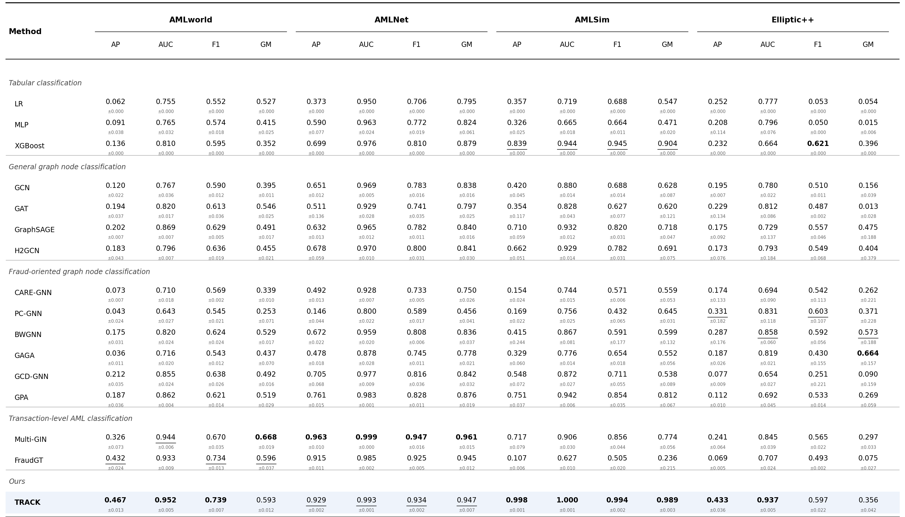

# TRACK

Code for **TRACK: Multiple Instance Learning for Anti-Money Laundering in
Transaction Networks** (WSDM 2027).

AML investigations are organized around accounts, but the evidence against an
account often sits in only a few of its transactions. Many account-level
detectors summarize transactions before learning, and message-passing models
average again over neighboring accounts. We call this the *aggregation
mismatch*.

TRACK recasts account-level AML detection as multiple instance learning. An
account-window is a bag, and its transactions are the instances.

1. **Instances.** Each transaction incident to an account becomes one instance.
   Its features describe the transaction itself (amount, direction, time of day,
   channel), the account's own history up to that moment, and the same history
   for the counterparty. Every feature uses only transactions at or before the
   instance's timestamp.
2. **Encoder.** A shared two-layer MLP encodes every transaction independently.
3. **Pooling.** A feature-wise max over the encoded transactions forms the
   account representation, and a classifier head turns it into the account
   score. Different transactions can supply different hidden dimensions, so
   sparse suspicious evidence is not averaged away.
4. **Supervision.** Training uses account-window labels only. Transaction labels
   are held out and used only to check whether the instance scores rank the
   flagged transactions first.

## Results

Detection on the test window, mean over five seeds (± standard deviation).
AP is average precision, AUC is AUROC, F1 is macro F1, and GM is G-mean. Bold
marks the best and underline the second best in each column.



The paper also reports a non-public interbank network. It is not included here.

## Setup

```bash
pip install -r requirements.txt
```

Python 3.10+ and PyTorch 2.x. A GPU is recommended; pass `--device cpu`
otherwise.

## Data

No dataset is redistributed. AMLworld (HI-Small) and AMLNet download with one
command:

```bash
python _datasets/fetch.py      # AMLworld needs a Kaggle token at ~/.kaggle/kaggle.json
```

AMLSim and Elliptic++ are downloaded by hand. See
[`_datasets/README.md`](_datasets/README.md) for the sources, licences and the
folder layout the loaders expect.

## Running TRACK

```bash
python run_track.py \
    --dataset amlworld \
    --output-dir results/track_amlworld \
    --split temporal \
    --encoder mlp \
    --poolings max \
    --counterparty-context \
    --seeds 2024 2025 2026 2027 2028 \
    --budgets 1.0 \
    --device cuda:0
```

`--dataset` is one of `amlworld`, `amlnet`, `amlsim`, `ellipticpp`. The other
arguments above are the paper's settings.

- `--split temporal` orders transactions by time and cuts them 60/20/20 into
  train, validation and test windows. A sample is an `(account, window)` pair.
- `--counterparty-context` appends the counterparty's history to each instance.
- Bags are capped at the 99th percentile of per-account transaction count, at
  most 1,024 (`--cap-quantile`, `--cap-max`).
- The learning rate (`--lrs 3e-4 1e-3`) and width (`--hidden 64 128`) are
  searched on validation AP. Training stops early after 30 epochs without
  improvement (`--patience`).
- `--poolings mean attention maxscore` runs the pooling variants from the
  ablation, and `--encoder set` adds self-attention across the bag.

Each run writes:

- `metrics/seed_metrics.csv`: one row per (pooling, seed, budget) with test AP
  (`auprc`), AUROC, the validation-selected threshold, and the within-bag
  transaction ranking metrics (`instance_hit_at_k`, `instance_map_per_bag`)
- `preds/`: the test scores behind those numbers
- `manifest.json`: the configuration and code revision

Model selection, early stopping and the decision threshold all use validation
data only. The test window is read once.

## Layout

```
run_track.py     entry point
model/           shared encoder and pooling (track.py, encoders.py)
_commons/        instance construction, metrics, ranking, provenance
_datasets/       loaders, temporal split, download helper
assets/          README figures
```

## Citation

```bibtex
@inproceedings{lim2027track,
  title     = {{TRACK}: Multiple Instance Learning for Anti-Money Laundering in Transaction Networks},
  author    = {Lim, Seonkyu and Tae, Inwoo and Hong, Gwangui and Lee, Jaehoon and
               Choi, Jeongwhan and Kim, Taehoon and Lee, Yongjae and Kim, Min-Soo},
  booktitle = {Proceedings of the Twentieth ACM International Conference on Web Search and Data Mining (WSDM '27)},
  year      = {2027},
  address   = {Hong Kong SAR, China},
  publisher = {ACM}
}
```

## License

MIT. See [LICENSE](LICENSE).
